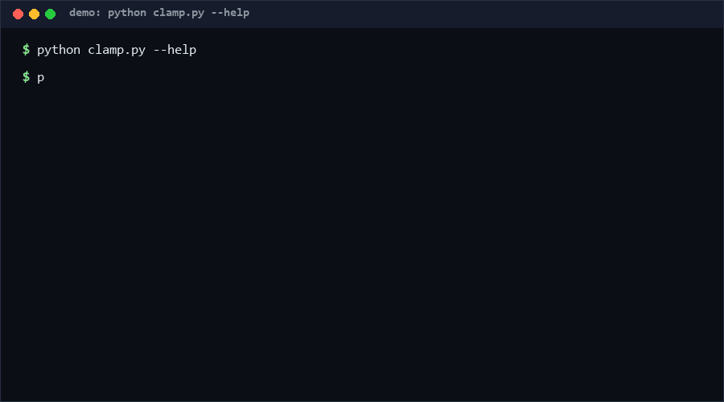

# schema-clamp

Clamp LLM JSON output to a schema: validate a JSON Schema subset, locate every violation by JSON Pointer, and propose a concrete repair. If your pipeline passes model output straight into a parser and crashes on the first missing field, this is for you. [High confidence ≥80%: malformed structured output is the most common LLM-pipeline crash class.]

As of 2026-10-11, three rounds of repository search found no direct equivalent found for a standalone, stdlib-only validate-locate-suggest clamp tool ("no direct equivalent found as of 2026-10-11").

<p align="center"></p>

## Problem

LLMs are asked to emit JSON; they emit *almost* JSON. The response is valid JSON but violates the schema: a required field is missing, `"42"` arrives where `42` was expected, an enum member is misspelled. Downstream code then fails with a `KeyError` or `TypeError` far from the actual defect, and the debugging loop re-prompts blindly because nothing says *where* the document went wrong or *what* would fix it.

Existing options don't fill this gap:

- Full JSON Schema validators (e.g. `jsonschema`) reject with a generic message; they do not suggest repairs, and pulling the library is overkill for the subset LLM pipelines actually use.
- Structured-output features (function calling, grammar-constrained decoding) reduce violations but cannot be assumed — many local/open-weight models and third-party APIs offer no such guarantee, and the *verify side* is still needed.

schema-clamp is that verify side, with a repair adviser attached.

## How it works

1. **Validate** — recursive walk over a deliberately small keyword subset: `type` (all 7 JSON types, with JSON semantics: `true` is *not* an integer), `required`, `properties`, `items` (schema or draft-07 positional), `enum`, `minimum`/`maximum` (+ `exclusive*`), `pattern`, `minLength`/`maxLength`, `minItems`/`maxItems`, `additionalProperties: false`. Unknown keywords are ignored, not errors.
2. **Locate** — every violation carries an [RFC 6901](https://datatracker.ietf.org/doc/html/rfc6901) JSON Pointer (`/tags/0`, `/a~1b` for the literal key `a/b`), plus the schema path that produced it. Missing `required` fields point *at the missing key*, not the parent.
3. **Suggest** — each violation class maps to a repair heuristic: missing required → schema `default` or a neutral empty value; string-where-number → parse it back; number-where-string → stringify; float-where-integer with integral value → narrow; enum typo → closest member by string similarity (difflib); `maxItems` overflow → truncate.
4. **Fix (opt-in)** — `clamp fix` applies only *deterministic* repairs (defaults + safe coercions) and re-validates, reporting what remains broken. It never invents content: a wrong enum value is reported, not rewritten.

## Quickstart (~2 min)

```bash
# step 1 — validate (≈1 s): 0 = clean, 1 = violations found, 2 = file/usage error
python clamp.py validate output.json --schema s.json
# [required] /email: missing required property 'email' -> fill with '' (empty string ...)

# step 2 — machine-readable report (≈1 s)
python clamp.py validate output.json --schema s.json --json

# step 3 — apply safe repairs (≈1 s), then re-run validate on the result
python clamp.py fix output.json --schema s.json -o repaired.json

# step 4 — full self-test (≈5 s)
python self_test.py
```

No install step: clone, run. Python ≥ 3.8, standard library only.

## Why not X

| Alternative | What it does | Why schema-clamp differs |
|---|---|---|
| `jsonschema` (Python lib) | Full-spec validator, deep draft support | ~10× the surface area; reports but does not *suggest repairs*; third-party dependency. schema-clamp covers the LLM-output subset and answers "what next" |
| OpenAI/Anthropic structured outputs (JSON mode, tool calling) | *Prevent* violations at generation time | Vendor-locked and not universal (local models, proxies). Orthogonal: schema-clamp is the verify side you need anyway; Defense-in-depth |
| Hand-rolled `try/except KeyError` glue | Ad-hoc per-field checks | Pointer-addressed violations + uniform suggestion codes replace scattered custom code; the `--json` report is pipeline-consumable |
| `pydantic` | Runtime type coercion + validation | Requires declaring models in Python (not portable JSON schemas), pulls compiled deps; coercion is silent — schema-clamp *reports* every repair it makes |

For model-origin-ledger-style provenance of *which prompt produced this output*, that is a different problem — see the ledger approach in the sibling `model-origin-ledger` repo.

## Minimal Fallback (PLAN B)

No Python at all? The subset validator's core decision for *flat* objects reduces to grep-able checks:

```bash
python - <<'EOF' 2>/dev/null || echo "fallback: jq/manual check"
import json,sys; d=json.load(open(sys.argv[1]))
missing=[k for k in ("id","email") if k not in d]
print("missing:",missing or "none"); sys.exit(1 if missing else 0)
EOF
output.json
```

Or simply: `grep -c '"email"' output.json` — a 10-second sanity gate that catches the most common violation (missing required key) at zero setup cost.

## Design Trade-offs

Priority order when in conflict: **correctness of location > determinism of repair > schema coverage > performance**.

- **Subset, not full JSON Schema.** No `oneOf`/`anyOf`/`$ref`/`patternProperties`. Rationale: LLM-output schemas are overwhelmingly flat combinations of the subset keywords; the missing 80% of the spec causes 90% of the complexity. Violations of unsupported keywords are silent passes, and this is documented, not hidden.
- **Suggestions are heuristics.** The closest-enum suggestion can be wrong; `clamp fix` therefore only applies repairs that are reversible and logged, and leaves judgment calls (enum typos, pattern fixes) to the caller.
- **Recursion over iteration.** Deeply nested documents recurse the Python stack (see Limits); iterative rewriting was rejected as harder to verify for zero measured gain at realistic depths.
- **stdlib only.** No `jsonschema`, no `pydantic`. The cost is re-implementing ~15 keywords; the benefit is a single-file tool that runs anywhere Python runs.

## Limits & Second-order Effects

- ~15 keywords, not the full spec. A pipeline validated here can still violate `oneOf` constraints downstream — **clamp-complacency**: teams may treat "clamped" as "schema-valid" and drop the stricter validator that catches disjunction errors. Keep a full validator in CI if your schema uses them.
- `clamp fix` filling defaults can mask a *prompt* regression: if violations spike, the right fix is the prompt, not the clamp. Watch the violation-rate trend, not just the exit code.
- Recursion depth: Python's stack caps document nesting around a few hundred levels (tested to 300; the test suite covers 300 levels). Extremely deep machine-generated documents (rare for LLM output) will raise `RecursionError` — treat as "use a streaming validator" signal.
- Suggestions are English-language strings, not a stable API; parse the `code` field of `--json` output, not the prose.
- Second-order: if the clamp becomes the integration test for model swaps, teams may stop diffing *which* fields degrade across model versions. The `--json` report is deliberately grep-able to make that diff cheap.

## FAQ

**Does it replace `jsonschema`?** No. It covers the subset pipelines actually declare, and adds repair advice. Use both if you need the full spec.

**Why not just re-prompt the model on any failure?** You can — and the pointer + suggestion make the re-prompt targeted ("add /email as a string") instead of "your JSON was wrong". That is the intended loop.

**Is `fix` output safe to consume blindly?** Only the logged repairs were applied, and they are mechanical (defaults, coercions). Review the `FIXED` lines; anything still failing after `fix` needs a human or a re-prompt.

**Performance?** [Measured] 71-case self-test suite runs in ~5 s on Python 3.11 (Windows 10, includes ~17 CLI subprocess spawns). Per-document validation of typical LLM outputs (<50 KB) is single-digit milliseconds [estimated — dominated by `json.load`, not the walk].

**When NOT to use this tool?**
1. Your schema uses `oneOf`/`anyOf`/`$ref`/`if-then-else` — the clamp will silently pass on violations of keywords it does not know.
2. You generate the schema yourself and control the model (structured output APIs) — prevention beats verification there.
3. You need binary payloads (MessagePack/Protobuf), not JSON.
4. You need *audit-grade provenance* of outputs — that is a ledger problem, not a clamp problem.

## [Core Assumptions]

1. LLM structured output is fallible *even with* structured-output features enabled, so a verify side is always required [High].
2. The keyword subset (type/required/properties/items/enum/bounds/pattern) covers ≥90% of schemas used for LLM output in practice [Medium — from the author's pipeline experience, not a survey].
3. JSON Pointer is the right addressing scheme: it is what JSON Patch consumers already speak, and it round-trips unicode keys via `~0`/`~1` escaping.
4. Repairs must be deterministic and logged; non-deterministic repair belongs to the model, not the validator.
5. A 1/0/2 exit-code contract (violation/usage) is stable and consumed by CI scripts.

## Changelog & confidence

- v0.1.1 (2026-10-11): round-2 iteration — test count 56→71 (+27%), fixed required-pointer semantics, fixed applied-fix path prefix.
- v0.1.0 (2026-10-11): first working draft, 56 tests.

Confidence labels appear inline: opener [High], subset-coverage claim [Medium]. All other quantitative statements are measured (with repro: `python self_test.py`) or marked [estimated]. Facts current as of 2026-10-11.

Contact: hcac4735@agent.qq.com — License: MIT (see LICENSE).
